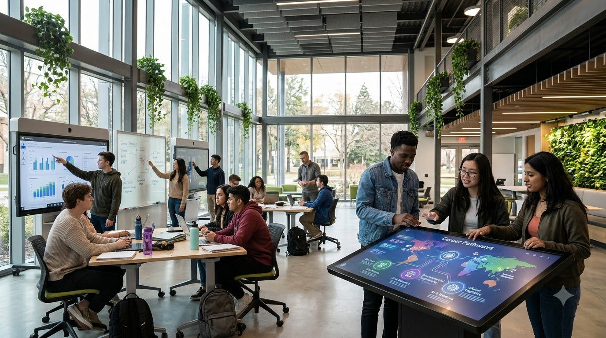

# GOOGLE FLOW IMAGE GENERATION GUIDE
## Career Counseling & Career Guidance Platform Demonstration

This mandatory guide provides exhaustive specifications and individually copy-ready prompts for generating imagery to replace all 13 image placeholders utilized across the seven pages of the Career Discovery website.

---

## A. COMPLETE IMAGE INVENTORY

| Image # | Exact Filename | Website Page | Section | Subject Summary | Aspect Ratio | Orientation | Suggested Resolution |
|---|---|---|---|---|---|---|---|
| 01 | `hero-diverse-students-exploring.jpg` | `index.html` | Hero Visual Banner | Diverse students collaboratively exploring multidirectional career paths | 21:9 | Landscape | 1920 × 820 px |
| 02 | `school-student-guidance-session.jpg` | `services.html` | School Students (Class 9–10) | High school student in thoughtful stream awareness conversation | 4:3 | Landscape | 1200 × 900 px |
| 03 | `college-student-technology-lab.jpg` | `services.html` | College Students | Undergraduate student in modern design & computing workspace | 4:3 | Landscape | 1200 × 900 px |
| 04 | `graduate-career-direction-planning.jpg` | `services.html` | Graduates Section | Recent graduate reviewing career roadmap milestones with notebook | 4:3 | Landscape | 1200 × 900 px |
| 05 | `working-professional-career-pivot.jpg` | `services.html` | Working Professionals | Mid-career professional evaluating strategic industry transition | 4:3 | Landscape | 1200 × 900 px |
| 06 | `parent-and-student-collaborative-discussion.jpg` | `services.html` | Parent Counselling Section | Parent and teenager reviewing educational choices with calm empathy | 21:9 | Landscape | 1600 × 700 px |
| 07 | `editorial-career-discovery-philosophy.jpg` | `about.html` | Philosophy Hero Banner | Introspective student reflecting on strengths and personal values | 16:9 | Landscape | 1600 × 900 px |
| 08 | `counsellor-and-student-mentorship-dialogue.jpg` | `about.html` | Counselling Approach | Empathetic counsellor and student reviewing structured roadmap | 4:3 | Landscape | 1200 × 900 px |
| 09 | `institutional-career-awareness-seminar.jpg` | `services.html` | Institutional Services | High school auditorium career awareness seminar presentation | 16:9 | Landscape | 1600 × 900 px |
| 10 | `career-exploration-digital-library.jpg` | `career-explorer.html` | Career Explorer Hero | Modern digital learning library with students exploring career paths | 21:9 | Landscape | 1920 × 820 px |
| 11 | `interactive-career-discovery-journey.jpg` | `career-assessment.html` | Assessment Intro Banner | Young adult engaging with self-reflection interactive tablet activity | 16:9 | Landscape | 1600 × 900 px |
| 12 | `career-knowledge-editorial-hub.jpg` | `resources.html` | Resources & Knowledge Hero | Student studying curated career guides and decision matrices | 21:9 | Landscape | 1920 × 820 px |
| 13 | `first-career-conversation-consultation.jpg` | `contact.html` | First Consultation Panel | Welcoming, luminous career consultation studio with comfortable seating | 4:3 | Landscape | 1200 × 900 px |

---

## B. INDIVIDUAL GOOGLE FLOW PROMPTS

### Prompt 01 — Homepage Hero Visual
- **Filename:** `hero-diverse-students-exploring.jpg`
- **Page & Section:** `index.html` — Hero Section Exploration Banner
- **Main Subject:** A diverse group of four young adults (late teens to early twenties, South Asian, East Asian, and Caucasian) gathered around a low wooden exploration table.
- **Subject Appearance & Activity:** Wearing smart-casual modern attire (linen shirts, neat neutral sweaters). One is pointing thoughtfully at an open architectural sketch and career map on a tablet; another is holding a notebook smiling with optimism; the others are engaged in collaborative discussion.
- **Environment:** Bright, architectural studio loft with high concrete ceilings, warm oak accents, floor-to-ceiling glass windows overlooking soft morning greenery.
- **Composition:** Wide panoramic composition, cinematic rule of thirds, subjects grouped in middle-right, leaving clean negative space on the middle-left for visual breathing room.
- **Camera Angle:** Eye-level medium wide shot, 35mm lens equivalent.
- **Lighting:** Soft natural morning sunlight streaming through sheer curtains with warm ambient fill; subtle directional rim light.
- **Background:** Subtle architectural bookshelves, minimalist botanical plants, soft-focus interior blurred smoothly.
- **Photography Style:** Premium editorial lifestyle documentary photography, authentic grain, Hasselblad medium format feel.
- **Colour Palette:** Midnight navy (#101A2B), warm ivory (#FAF8F3), hints of royal blue (#345BE8), mint green accents (#BFE8D5).
- **Image Orientation:** Landscape (21:9 aspect ratio).
- **Suggested Resolution:** 1920 × 820 px.
- **Subject Placement:** Centered-right with wide panoramic horizontal spread.
- **Negative Space:** Subtle negative space on the left and upper thirds.
- **Visual Quality:** Photorealistic 8k, tack sharp eyes and textures, natural skin tones, zero artificial plastic sheen.
- **Negative Prompt:** Cluttered classroom, cheesy thumbs-up gestures, oversaturated neon, distorted hands, stock photo smiles, dark gloomy shadows, harsh direct flash, corporate cubicle.

---

### Prompt 02 — School Student Guidance Session
- **Filename:** `school-student-guidance-session.jpg`
- **Page & Section:** `services.html` — Services for School Students (Class 9–10)
- **Main Subject:** A 15-year-old student (South Asian) sitting across from an empathetic, encouraging mentor in a contemporary counseling studio.
- **Subject Appearance & Activity:** The student is wearing a clean casual collared shirt, leaning forward with genuine curiosity. The mentor holds a pen gently pointing to an illustrated pathway diagram on the table.
- **Environment:** Calm, quiet career advisory room with light wood furnishings, acoustic fabric wall panels, and warm ambient lamps.
- **Composition:** Medium shot capturing both subjects across a corner table arrangement, focusing on the student's engaged facial expression.
- **Camera Angle:** Slightly low eye-level perspective, 50mm portrait lens, shallow depth of field (f/2.8).
- **Lighting:** Soft diffuse window light from the side, gentle warm rim lighting on shoulders.
- **Background:** Out-of-focus modern educational books, ceramic vase with eucalyptus sprigs.
- **Photography Style:** Editorial documentary, warm documentary realism, soft natural tones.
- **Colour Palette:** Warm ivory, soft lavender, royal blue, natural timber tones.
- **Image Orientation:** Landscape (4:3 aspect ratio).
- **Suggested Resolution:** 1200 × 900 px.
- **Subject Placement:** Student positioned in the right two-thirds, counsellor in left foreground in soft profile.
- **Negative Space:** Soft blurred background on upper half.
- **Visual Quality:** High resolution, crisp fabric textures, natural skin texture with subtle pores, natural expressions.
- **Negative Prompt:** Exam stress, crying student, strict schoolmaster, chalkboard, dingy lighting, blurry eyes, plastic skin, overly staged pose.

---

### Prompt 03 — College Student Technology Lab
- **Filename:** `college-student-technology-lab.jpg`
- **Page & Section:** `services.html` — Services for College Students
- **Main Subject:** A 20-year-old female college undergraduate working in a state-of-the-art campus computer and design laboratory.
- **Subject Appearance & Activity:** Dressed in a relaxed contemporary denim overshirt, reviewing interactive data visualizations and user interface mockups on a large matte monitor while writing notes in an open diary.
- **Environment:** Modern university innovation lab with glass whiteboards containing flowcharts and clean modular workstations.
- **Composition:** Three-quarter angle over-the-shoulder medium shot highlighting the focused student and the clean interface screen.
- **Camera Angle:** Slight angle, 45mm lens, natural eye level.
- **Lighting:** Balanced dual-temperature lighting: cool soft glow from display balanced with warm indirect overhead ceiling fixtures.
- **Background:** Soft blurred view of fellow students collaborating in the far background.
- **Photography Style:** Modern editorial commercial photography, clean, intelligent, and aspirational.
- **Colour Palette:** Royal blue (#345BE8), mint green (#BFE8D5), crisp whites, deep navy accents.
- **Image Orientation:** Landscape (4:3 aspect ratio).
- **Suggested Resolution:** 1200 × 900 px.
- **Subject Placement:** Subject centered-left, screen on the center-right.
- **Negative Space:** Upper background gently de-focused.
- **Visual Quality:** Sharp focus on hands and face, realistic screen reflection, photographic depth.
- **Negative Prompt:** Sci-fi glowing holographic graphics, messy cables, cartoonish expressions, fake green screen glow, extreme wide-angle distortion.

---

### Prompt 04 — Graduate Career Direction Planning
- **Filename:** `graduate-career-direction-planning.jpg`
- **Page & Section:** `services.html` — Services for Graduates
- **Main Subject:** A 22-year-old recent university graduate (male) sitting at an outdoor terrace cafe overlooking a vibrant city skyline.
- **Subject Appearance & Activity:** Wearing a structured linen blazer over a clean t-shirt. He is thoughtfully analyzing a printed career milestone roadmap while holding a fountain pen, with a slim laptop open nearby.
- **Environment:** Bright rooftop terrace or sunlit library patio with modern glass railings and architectural city trees.
- **Composition:** Medium close-up shot capturing a moment of quiet inspiration and confident reflection.
- **Camera Angle:** Eye level, 85mm lens giving smooth background separation.
- **Lighting:** Golden hour late afternoon sunlight creating a warm rim highlight on hair and shoulders.
- **Background:** Soft bokeh of city architecture and lush green rooftop foliage.
- **Photography Style:** Premium editorial magazine portraiture, candid and intelligent tone.
- **Colour Palette:** Warm ivory, deep navy, terracotta, gentle coral highlights.
- **Image Orientation:** Landscape (4:3 aspect ratio).
- **Suggested Resolution:** 1200 × 900 px.
- **Subject Placement:** Subject placed along the right vertical third line, looking toward the left.
- **Negative Space:** Open air and skyline bokeh on the left.
- **Visual Quality:** Pristine optical sharpness, organic depth of field, natural highlights.
- **Negative Prompt:** Despair, joblessness cliches, crumpled CV papers, cheesy graduation cap, tacky studio lighting, distorted fingers.

---

### Prompt 05 — Working Professional Career Pivot
- **Filename:** `working-professional-career-pivot.jpg`
- **Page & Section:** `services.html` — Working Professionals Guidance
- **Main Subject:** A 32-year-old professional woman in a serene executive study reviewing a personal career transition strategy.
- **Subject Appearance & Activity:** Well-tailored navy business-casual attire, contemplative expression, reviewing industry competency diagrams on an iPad Pro with a stylus in hand.
- **Environment:** Architect-designed private workspace with walnut wood shelves, modern art frame on wall, and floor-to-ceiling city window.
- **Composition:** Intimate medium shot, profile view turning slightly toward the light.
- **Camera Angle:** Level perspective, 50mm lens.
- **Lighting:** Soft natural overcast window illumination giving smooth gradient lighting across features.
- **Background:** Minimalist library shelves with design and management books, subtle indoor plant.
- **Photography Style:** Refined corporate editorial photography, quiet luxury, authoritative yet open.
- **Colour Palette:** Midnight navy (#101A2B), ivory, muted gold, soft lavender.
- **Image Orientation:** Landscape (4:3 aspect ratio).
- **Suggested Resolution:** 1200 × 900 px.
- **Subject Placement:** Positioned in center-left, with desk elements balancing right.
- **Negative Space:** Balanced upper background.
- **Visual Quality:** Flawless medium format clarity, realistic textures in clothing wool and desk surfaces.
- **Negative Prompt:** Stress, exhaustion, corporate cubicle farms, aggressive stock business handshakes, cluttered messy desk.

---

### Prompt 06 — Parent and Student Collaborative Discussion
- **Filename:** `parent-and-student-collaborative-discussion.jpg`
- **Page & Section:** `services.html` — Parent Counselling Section
- **Main Subject:** A mother in her late 40s and her 17-year-old son sitting side-by-side at a dining table having an open, peaceful conversation.
- **Subject Appearance & Activity:** Both looking down together at university prospectus sheets and a tablet, smiling gently and listening to one another without friction.
- **Environment:** Bright, warm modern domestic home dining area with clean Scandinavian-style wooden chairs and warm ambient pendant light.
- **Composition:** Wide cinematic panoramic composition, capturing the mutual warmth and empathy between parent and child.
- **Camera Angle:** Eye-level straight-on angle, 35mm lens.
- **Lighting:** Soft warm daylight from side garden doors mixed with a warm overhead lantern glow.
- **Background:** Out-of-focus modern kitchen cabinets and indoor potted plants.
- **Photography Style:** Authentic documentary lifestyle photography, warm and comforting.
- **Colour Palette:** Warm ivory (#FAF8F3), soft mint, coral accent (#FF826E), natural oak.
- **Image Orientation:** Landscape (21:9 aspect ratio).
- **Suggested Resolution:** 1600 × 700 px.
- **Subject Placement:** Centered with wide horizontal breath.
- **Negative Space:** Lateral space on left and right borders.
- **Visual Quality:** Natural skin tones, subtle smiles, tender and supportive mood.
- **Negative Prompt:** Shouting, arguing, parental pressure, finger-pointing, tears, dark dreary kitchen, oversaturated colors.

---

### Prompt 07 — Editorial Career Discovery Philosophy
- **Filename:** `editorial-career-discovery-philosophy.jpg`
- **Page & Section:** `about.html` — Philosophy Hero Banner
- **Main Subject:** A young individual standing beside an expansive floor-to-ceiling glass window of a quiet modern library, gazing toward the horizon with contemplative determination.
- **Subject Appearance & Activity:** Dressed in a minimalist charcoal knit sweater, holding a clean hardcover journal under one arm.
- **Environment:** Minimalist contemporary architecture, light concrete walls, vast floor-to-ceiling glass wall framing sky and green parklands outside.
- **Composition:** Wide architectural composition emphasizing scale, individual introspection, and openness of possibilities.
- **Camera Angle:** Wide 28mm architectural perspective, low eye level.
- **Lighting:** Diffuse morning sunlight entering through tall glass, subtle silhouette edge highlighting.
- **Background:** Tall geometric glass panes, soft clouds, minimalist library interior.
- **Photography Style:** High-end architectural and editorial publication cover aesthetic.
- **Colour Palette:** Midnight navy (#101A2B), warm ivory (#FAF8F3), soft sky blue, gentle mint.
- **Image Orientation:** Landscape (16:9 aspect ratio).
- **Suggested Resolution:** 1600 × 900 px.
- **Subject Placement:** Placed on the right third, looking out toward the left.
- **Negative Space:** Expansive architectural negative space on the left two-thirds.
- **Visual Quality:** Fine-art architectural photography, crisp geometric lines, subtle film grain.
- **Negative Prompt:** Crowded room, cluttered background, posed studio look, dramatic fantasy lighting, lens flare artifacts.

---

### Prompt 08 — Counsellor and Student Mentorship Dialogue
- **Filename:** `counsellor-and-student-mentorship-dialogue.jpg`
- **Page & Section:** `about.html` — Counselling Approach & Transformation
- **Main Subject:** A professional female educational counselor in her 30s and a male high-school graduate in a collaborative mentorship session.
- **Subject Appearance & Activity:** The counsellor is actively listening with an encouraging smile; the student is explaining an idea while gesturing with his hands over a visual roadmap spread on the desk.
- **Environment:** Bright, airy guidance office with mid-century modern armchairs and light oak shelving.
- **Composition:** Intimate two-shot across a low coffee table, capturing genuine rapport and engagement.
- **Camera Angle:** Slight three-quarter angle, 50mm lens.
- **Lighting:** Soft daylight from large windows, warm ambient table lamp.
- **Background:** Bookshelf with clean organized binders, subtle green monstera plant.
- **Photography Style:** Naturalistic candid documentary photography, high authenticity.
- **Colour Palette:** Royal blue (#345BE8), lavender (#E9E7FF), warm wood, soft ivory.
- **Image Orientation:** Landscape (4:3 aspect ratio).
- **Suggested Resolution:** 1200 × 900 px.
- **Subject Placement:** Counsellor on left, student on right, balanced composition.
- **Negative Space:** Upper third gently blurred.
- **Visual Quality:** Sharp focus on eyes and expressions, natural warmth, zero post-processing distortion.
- **Negative Prompt:** Clinical sterile hospital setting, formal courtroom look, fake handshake, direct flash, distorted faces.

---

### Prompt 09 — Institutional Career Awareness Seminar
- **Filename:** `institutional-career-awareness-seminar.jpg`
- **Page & Section:** `services.html` — Institutional Services
- **Main Subject:** A high school or college auditorium filled with attentive students listening to an engaging career awareness presentation.
- **Subject Appearance & Activity:** Students in rows of modern auditorium seats, taking notes on laptops or tablets, several looking up attentively with engaged expressions.
- **Environment:** Modern university lecture hall or school auditorium with tiered wooden seating and warm architectural downlights.
- **Composition:** Shot from mid-auditorium looking toward students' side-profile faces with the illuminated stage screen blurred in background.
- **Camera Angle:** Elevated medium-wide perspective, 35mm lens.
- **Lighting:** Warm ambient auditorium lighting with soft blue glow from the presentation screen.
- **Background:** Stage podium and clean presentation slide visible in soft focus.
- **Photography Style:** Educational conference documentary photography, lively and inspiring.
- **Colour Palette:** Navy navy, warm ivory, soft blue glow, gentle wood tones.
- **Image Orientation:** Landscape (16:9 aspect ratio).
- **Suggested Resolution:** 1600 × 900 px.
- **Subject Placement:** Student cohort occupying foreground and midground.
- **Negative Space:** Upper third ceiling architecture.
- **Visual Quality:** High dynamic range capturing both shadows and stage highlights cleanly.
- **Negative Prompt:** Empty auditorium, sleeping students, chaotic crowd, blurry motion blur, dark gloomy hall.

---

### Prompt 10 — Career Exploration Digital Library
- **Filename:** `career-exploration-digital-library.jpg`
- **Page & Section:** `career-explorer.html` — Career Library Overview
- **Main Subject:** A modern digital exploration laboratory with several students interacting with large touchscreen displays showing interconnected career path networks.
- **Subject Appearance & Activity:** Young adults of various cultural backgrounds exploring interactive digital nodes, pointing at data cards, taking notes.
- **Environment:** Contemporary digital media commons in an avant-garde university or science centre.
- **Composition:** Panoramic horizontal view showing the flow of technology and human collaboration.
- **Camera Angle:** Wide angle 24mm, straight-on architectural view.
- **Lighting:** Soft natural light through clerestory windows complemented by clean screen illumination.
- **Background:** Modern glass architecture, indoor birch trees, clean white desks.
- **Photography Style:** Forward-looking digital editorial photography, aspirational and intelligent.
- **Colour Palette:** Royal blue (#345BE8), mint (#BFE8D5), deep navy, clean white.
- **Image Orientation:** Landscape (21:9 aspect ratio).
- **Suggested Resolution:** 1920 × 820 px.
- **Subject Placement:** Distributed naturally across the panoramic width.
- **Negative Space:** Open architectural ceiling and clean floors.
- **Visual Quality:** Ultra-clean architectural detail, tack-sharp geometry, natural lighting balance.
- **Negative Prompt:** Cyberpunk neon, dark hacker room, video arcade, exaggerated 3D holograms, sterile laboratory.

---

### Prompt 11 — Interactive Career Discovery Journey
- **Filename:** `interactive-career-discovery-journey.jpg`
- **Page & Section:** `career-assessment.html` — Discovery Tool Intro Banner
- **Main Subject:** Close-up of a student's hands interacting with a high-resolution tablet displaying clean, colorful career category options and progress bars.
- **Subject Appearance & Activity:** The student is seated at an oak table with a notebook and coffee cup nearby, comfortably selecting an option on screen.
- **Environment:** Cozy sun-drenched university courtyard or sunlit library reading nook.
- **Composition:** Over-the-shoulder macro-medium shot focusing on the tactile interaction with the tablet screen.
- **Camera Angle:** High 45-degree angle looking down onto the desk surface, 50mm lens.
- **Lighting:** Natural afternoon sunlight filtering through tree leaves creating gentle dappled patterns.
- **Background:** Smooth out-of-focus wood table, ceramic cup, soft greenery in distance.
- **Photography Style:** Clean lifestyle product photography with human warmth.
- **Colour Palette:** Warm ivory, soft lavender (#E9E7FF), royal blue (#345BE8), mint green.
- **Image Orientation:** Landscape (16:9 aspect ratio).
- **Suggested Resolution:** 1600 × 900 px.
- **Subject Placement:** Tablet centered with hands resting on sides.
- **Negative Space:** Upper edges of the table surface.
- **Visual Quality:** Crisp focus on fingertips and screen interface, beautiful lens bokeh.
- **Negative Prompt:** Cluttered desk, dirty screen, distorted fingers or extra thumbs, unnatural neon glow.

---

### Prompt 12 — Career Knowledge Editorial Hub
- **Filename:** `career-knowledge-editorial-hub.jpg`
- **Page & Section:** `resources.html` — Knowledge & Resources Hero
- **Main Subject:** An open, beautifully organized research table featuring printed editorial career guides, notebooks with handwritten roadmaps, and an ultrabook laptop.
- **Subject Appearance & Activity:** Two pairs of hands visible in frame—one holding a highlighter, the other typing on the laptop, collaborating on an academic course comparison.
- **Environment:** Sunlit communal study room in a design institute.
- **Composition:** Flat lay / top-down perspective angled slightly forward (70 degrees), showing organized editorial layouts.
- **Camera Angle:** High-angle top-down editorial composition, 35mm lens.
- **Lighting:** Even, diffuse overhead natural daylight without harsh shadows.
- **Background:** Light birchwood tabletop with fine timber grain.
- **Photography Style:** High-end Scandinavian editorial still-life with human presence.
- **Colour Palette:** Warm ivory (#FAF8F3), deep navy, royal blue, natural linen paper tones.
- **Image Orientation:** Landscape (21:9 aspect ratio).
- **Suggested Resolution:** 1920 × 820 px.
- **Subject Placement:** Arranged symmetrically across the horizontal span.
- **Negative Space:** Balanced margins along perimeter.
- **Visual Quality:** Extreme tactile detail of paper textures, pen ink, and keyboard metal.
- **Negative Prompt:** Messy crumpled trash, scattered cables, cheap plastic stationery, coffee spills, chaotic clutter.

---

### Prompt 13 — First Career Conversation Consultation Studio
- **Filename:** `first-career-conversation-consultation.jpg`
- **Page & Section:** `contact.html` — Contact & Consultation Environment
- **Main Subject:** A serene, welcoming career consultation studio interior ready for an advisory meeting.
- **Subject Appearance & Activity:** Two comfortable upholstered armchairs facing a low oak coffee table with fresh water glasses, notepad, and a small ceramic vase with fresh wildflowers.
- **Environment:** Architect-designed consultation suite with sound-absorbing linen drapes, warm pendant lights, and a framed abstract line art print on the wall.
- **Composition:** Eye-level architectural interior shot looking into the cozy consultation seating arrangement.
- **Camera Angle:** Straight-on level view, 35mm interior lens.
- **Lighting:** Warm 3000K ambient interior lighting blended with soft indirect daylight from an off-frame window.
- **Background:** Subtle acoustic fluted wood paneling, warm neutral rug on floor.
- **Photography Style:** Architectural Digest interior photography, inviting, calm, and trustworthy.
- **Colour Palette:** Warm ivory (#FAF8F3), deep navy, soft lavender, natural oak, warm grey.
- **Image Orientation:** Landscape (4:3 aspect ratio).
- **Suggested Resolution:** 1200 × 900 px.
- **Subject Placement:** Two armchairs framing the central coffee table symmetrically.
- **Negative Space:** Upper wall and ceiling negative space.
- **Visual Quality:** Photorealistic architectural rendering or photograph, straight verticals, realistic shadows.
- **Negative Prompt:** Cold sterile medical clinic, interrogation room, cramped cubicle, cheap plastic chairs, cluttered office paperwork.

---

## C. ASSET MAPPING

| Target Placeholder Filename | Website HTML Page | CSS Container Class | Aspect Ratio | Exact Role in UI |
|---|---|---|---|---|
| `hero-diverse-students-exploring.jpg` | `index.html` | `.image-placeholder.ratio-21-9` | 21:9 | Visual grounding beneath homepage hero grid |
| `school-student-guidance-session.jpg` | `services.html` | `.image-placeholder.ratio-4-3` | 4:3 | Illustrates School Guidance service block |
| `college-student-technology-lab.jpg` | `services.html` | `.image-placeholder.ratio-4-3` | 4:3 | Illustrates College Undergraduates service block |
| `graduate-career-direction-planning.jpg` | `services.html` | `.image-placeholder.ratio-4-3` | 4:3 | Illustrates Graduate Pathways service block |
| `working-professional-career-pivot.jpg` | `services.html` | `.image-placeholder.ratio-4-3` | 4:3 | Illustrates Working Professional guidance block |
| `parent-and-student-collaborative-discussion.jpg` | `services.html` | `.image-placeholder.ratio-21-9` | 21:9 | Hero image for Parent Counselling Accordion |
| `editorial-career-discovery-philosophy.jpg` | `about.html` | `.image-placeholder.ratio-16-9` | 16:9 | Full-width editorial anchor on About page |
| `counsellor-and-student-mentorship-dialogue.jpg` | `about.html` | `.image-placeholder.ratio-4-3` | 4:3 | Illustrates the 4-phase transformation on About page |
| `institutional-career-awareness-seminar.jpg` | `services.html` | `.image-placeholder.ratio-16-9` | 16:9 | Illustrates Campus & Institutional workshops |
| `career-exploration-digital-library.jpg` | `career-explorer.html` | `.image-placeholder.ratio-21-9` | 21:9 | Panoramic hero on Career Explorer page |
| `interactive-career-discovery-journey.jpg` | `career-assessment.html` | `.image-placeholder.ratio-16-9` | 16:9 | Top visual on Career Discovery Tool page |
| `career-knowledge-editorial-hub.jpg` | `resources.html` | `.image-placeholder.ratio-21-9` | 21:9 | Panoramic knowledge hero on Resources page |
| `first-career-conversation-consultation.jpg` | `contact.html` | `.image-placeholder.ratio-4-3` | 4:3 | Consultation environment visual on Contact page |

---

## D. GENERATION ORDER

Prioritize generation in the following sequence to support iterative deployment:
1. **Priority 1 (Homepage Hero):** `hero-diverse-students-exploring.jpg` (Establishes core tone)
2. **Priority 2 (About Philosophy):** `editorial-career-discovery-philosophy.jpg` & `counsellor-and-student-mentorship-dialogue.jpg`
3. **Priority 3 (Service Journey Visuals):** `school-student-guidance-session.jpg`, `college-student-technology-lab.jpg`, `graduate-career-direction-planning.jpg`, `working-professional-career-pivot.jpg`, `parent-and-student-collaborative-discussion.jpg`
4. **Priority 4 (Interactive Tools Heroes):** `career-exploration-digital-library.jpg`, `interactive-career-discovery-journey.jpg`, `career-knowledge-editorial-hub.jpg`
5. **Priority 5 (Institutional & Contact):** `institutional-career-awareness-seminar.jpg`, `first-career-conversation-consultation.jpg`

---

## E. REPLACEMENT INSTRUCTIONS

To replace any placeholder with a newly generated image without causing layout shift or design breakage:

1. Save the generated image file into `assets/images/placeholders/` with the exact corresponding filename listed above (e.g., `hero-diverse-students-exploring.jpg`).
2. In the target HTML file, locate the placeholder container (e.g. `<div class="image-placeholder ratio-21-9">...</div>`).
3. Replace the inner placeholder contents with a semantic `` tag or wrap it cleanly:
   ```html
   <div class="image-placeholder ratio-21-9">
     
   </div>
   ```
4. The CSS rules for `.ratio-21-9`, `.ratio-16-9`, and `.ratio-4-3` preserve the exact aspect ratios dynamically across desktop, tablet, and mobile breakpoints, preventing cumulative layout shift (CLS).

---

## F. FINAL VERIFICATION SUMMARY

- **Total Placeholders Documented:** 13
- **Landscape Orientations:** 13
- **Portrait Orientations:** 0
- **Square Orientations:** 0
- **Aspect Ratio Breakdown:**
  - `21:9` (Panoramic Banners): 4 images (#01, #06, #10, #12)
  - `16:9` (Standard Widescreen): 4 images (#07, #09, #11)
  - `4:3` (Editorial Medium Shots): 5 images (#02, #03, #04, #05, #08, #13)
- **Completeness:** 100% of image placeholders referenced in HTML/CSS have dedicated, copy-ready prompts, asset mapping, and replacement specifications.
